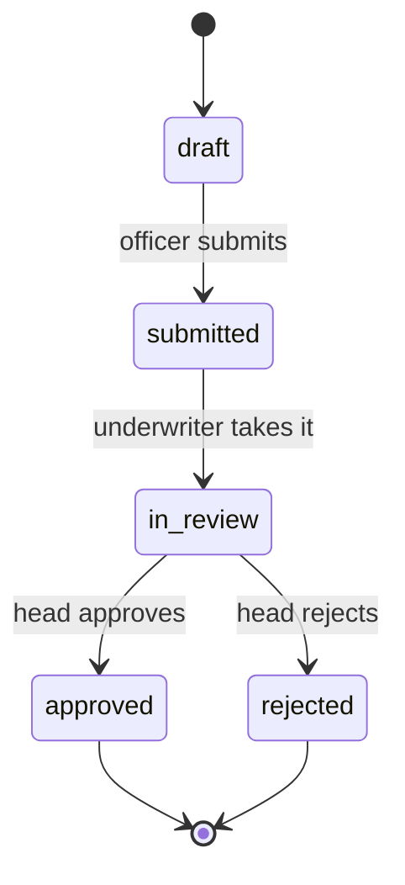

# loan-desk

A back-office for loan applications: a loan officer creates an application, an underwriter reviews it, a head of department approves it.

> **Status:** planned. This is the capstone of my learning path: I first build smaller projects (a todo API that grows from JSON-file storage to PostgreSQL, Redis and Celery, plus a Vue client), then build this one from scratch.

## What it does

Bank employees use loan-desk to move a loan application from draft to decision.



| Role | Can do |
|---|---|
| Loan officer | create and edit drafts, submit applications |
| Underwriter | review applications, see the client's income and debt load |
| Head of department | approve or reject |
| Admin | manage users and roles |

### Domain rules

- **Maker-checker.** The person who created an application cannot approve it.
- **Permissions are checked on the server.** A hidden button in the UI is a convenience, not protection.
- **Nothing is deleted.** Applications get cancelled, not removed, and every status change is recorded with who, when and from which status to which.
- **Money is never a float.** Amounts are stored as integers in tyiyn, the smallest unit of the som, and the server does all final calculations.

## Stack

| Layer | Technologies |
|---|---|
| Backend | Python 3.13, Django 5.2 LTS, Django REST Framework, SimpleJWT |
| Database | PostgreSQL in Docker |
| Cache and background jobs | Redis, Celery |
| Frontend | Vue 3 (Composition API, `<script setup>`), TypeScript, Vite, Vue Router, Pinia |
| Infrastructure | Docker, Docker Compose, nginx, gunicorn |
| Tests | pytest-django, Vitest |

## Planned features

- [ ] **Accounts and ledger:** double-entry bookkeeping, balances calculated from entries, transfers inside `transaction.atomic` with row locking, idempotency keys against double charges
- [ ] **Loan applications:** status workflow, roles, maker-checker, audit log, payment schedule calculated on the server with `Decimal`
- [ ] **Background jobs:** monthly payment accrual with Celery beat, notifications, caching
- [ ] **UI:** Vue interface for applications and accounts, role-based
- [ ] **Ready to run:** tests, `docker compose up`, deployment
- [ ] **Later:** split notifications and scoring into separate services with RabbitMQ, an outbox and a gateway

## Getting started

Requirements: Node.js 22.

```bash
git clone https://github.com/er-Bilim/loan-desk.git
cd loan-desk/frontend
npm install
npm run dev
```

Backend instructions will be added when the backend is started.

## Project structure

```
loan-desk/
├── backend/    # Django + DRF API
└── frontend/   # Vue app
```

## Author

Bilim Erkinbekov, [@er-Bilim](https://github.com/er-Bilim)
