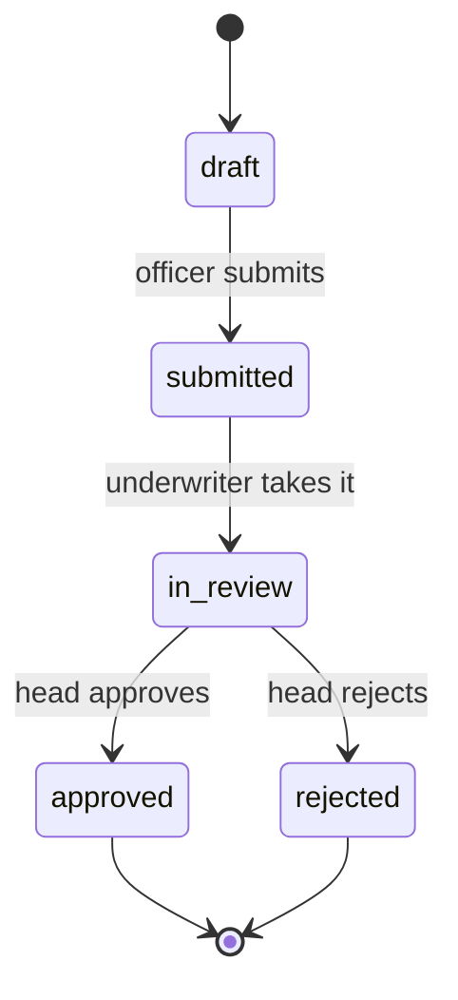

# loan-desk

A back-office for loan applications: a loan officer creates an application, an underwriter reviews it, a head of department approves it.

> **Status:** early development. This is a learning project. I'm using it to learn Vue, NestJS and GraphQL on a realistic banking domain, step by step. The roadmap below shows what is done and what is planned.

## What it does

Bank employees use loan-desk to move a loan application from draft to decision.



| Role | Can do |
|---|---|
| Loan officer | create and edit drafts, submit applications |
| Underwriter | review applications, see the client's income and debt load |
| Head of department | approve or reject |
| Admin | manage users and roles |

### Domain rules

- **Maker-checker.** The person who created an application cannot approve it.
- **Permissions are checked on the server.** A hidden button in the UI is a convenience, not protection.
- **Nothing is deleted.** Applications get cancelled, not removed, and every status change is recorded with who, when and from which status to which.
- **Money is never a float.** Amounts are stored as integers in tyiyn, the smallest unit of the som, and the server does all final calculations.

## Stack

| Layer | Technologies | Status |
|---|---|---|
| Frontend | Vue 3.5 (Composition API, `<script setup>`), TypeScript, Vite | in progress |
| | Vue Router, Pinia | planned |
| | GraphQL: Apollo Client + GraphQL Code Generator | planned |
| Backend | NestJS, GraphQL (code-first), DataLoader | planned |
| Database | PostgreSQL in Docker | planned |
| Auth | argon2, JWT access and refresh tokens in httpOnly cookies, refresh rotation, roles | planned |
| Tests | Vitest, Vue Test Utils, supertest | planned |
| Later | microservices with `@nestjs/microservices`, RabbitMQ | planned |

## Roadmap

- [ ] **0. Setup:** Vue + TypeScript project
- [ ] **1. Loan calculator:** annuity and differentiated payments with a full payment schedule
- [ ] **1.5. GraphQL basics:** queries, mutations and error handling with plain `fetch`
- [ ] **2. Applications UI:** list, details and a multi-step form on a mocked GraphQL API
- [ ] **3. Backend:** NestJS GraphQL API, PostgreSQL, status transitions, N+1 handled with DataLoader
- [ ] **4. Auth and roles:** login, refresh rotation, role-based access, maker-checker, audit log
- [ ] **5. Tests:** component, unit and e2e
- [ ] **6. Microservices:** scoring service, event-driven notifications with RabbitMQ, a separate auth service

## Getting started

Requirements: Node.js 22.

```bash
git clone https://github.com/er-Bilim/loan-desk.git
cd loan-desk/frontend
npm install
npm run dev
```

## Project structure

```
loan-desk/
├── frontend/   # Vue app
└── backend/    # NestJS API
```

## Author

Bilim Erkinbekov, [@er-Bilim](https://github.com/er-Bilim)